# Lojistas da Olist nos marketplaces: diagnóstico e direcionamento (2017-2018)

**Estudo independente** com a base pública da Olist, que é uma **amostra** dos dados da empresa.
**Autoria:** Fabian Aliatti Mayer definiu as perguntas, tomou as decisões de método e revisou cada resultado; a execução técnica teve apoio de inteligência artificial (Claude), como descrito na seção "Método".
**Natureza do documento:** relatório de **direcionamento**. Ele mostra onde estão os problemas e quais soluções merecem estudo primeiro. Nenhuma delas deve ser aplicada sem uma análise própria de custo e viabilidade.
**Período:** os indicadores gerais cobrem os pedidos de janeiro de 2017 a agosto de 2018. Quando uma análise usa outro recorte, o texto informa, e o Anexo A reúne todas as definições.

---

## Sumário executivo

A Olist ganha dinheiro quando seus lojistas vendem. Por isso, este relatório trata o **lojista como o cliente** da Olist e o comprador como cliente do marketplace onde a venda acontece.

Os dados apontam cinco conclusões principais:

1. **Vender pouco no começo é o sinal mais forte de que o lojista vai parar de vender.** Entre março e agosto de 2018, o número de lojistas ativos cresceu 27%, as vendas mensais caíram 13% e cada lojista passou a vender 32% menos. Entre os lojistas que fizeram uma só venda nos primeiros 90 dias, 80% pararam de vender; entre os que fizeram dez ou mais, 24%. Os lojistas novos que deslancham têm, com mais frequência, anúncios com descrição completa e frete de até 40% do preço. A descrição está nas mãos do lojista; quem controla o frete ainda precisa ser confirmado.
2. **A reputação nos marketplaces é coletiva e depende da entrega.** Pedidos entregues no prazo recebem nota média 4,29; pedidos atrasados, 2,27. Três em cada quatro avaliações com nota 1 tratam de entrega ou de erro de envio, e não do produto.
3. **A promessa de prazo exibida ao comprador é a mesma para situações muito diferentes.** Se fosse ajustada à rota de cada entrega, o prazo exibido no Sudeste poderia cair de 21 para 17 dias sem piorar as avaliações, e o atraso no Nordeste cairia pela metade.
4. **A distância limita as vendas.** Nos estados onde o prazo e o frete são maiores, uma parcela muito menor da população compra. Entre estados de renda parecida, cada dia a menos de prazo acompanha cerca de 12% mais compradores por habitante (a margem de erro vai de 8% a 16%).
5. **As soluções mais baratas devem ser estudadas primeiro:** ajustar a promessa de prazo, pedir a avaliação só depois da entrega, apoiar o lojista novo nos primeiros 90 dias e reativar lojistas que já venderam bem.

**Decisão recomendada:** aprovar, para os próximos 90 dias, três pilotos com grupo de comparação (parte dos lojistas ou das rotas recebe a mudança; o restante serve de referência). Os indicadores de cada piloto estão na seção 5.

| Piloto | O que muda | Como saber se funcionou |
|---|---|---|
| Promessa de prazo por rota (solução 1) | Promessa mais curta em rotas rápidas do Sudeste e mais longa em rotas lentas do Nordeste | Atraso, nota e conversão (parcela dos visitantes que compra) nas rotas do piloto, comparados com rotas sem mudança |
| Avaliação após a entrega (solução 2) | A pesquisa de satisfação só é enviada depois que o pedido chega | Participação das notas 1 de "não recebido" nos pedidos do piloto |
| Ativação do lojista novo (solução 7) | Revisão da descrição dos anúncios, acompanhamento da primeira venda e, se o lojista controlar o frete, revisão dos produtos com frete desproporcional | Percentual de lojistas com 5 ou mais pedidos em 90 dias: metade dos novos de um mês recebe o apoio, a outra metade serve de comparação |

---

## 1. O negócio e os dados

### Como a Olist funciona

A Olist anuncia os produtos de pequenos lojistas nos grandes marketplaces do país, como Mercado Livre, Amazon e Americanas. O lojista vende **sob a reputação da Olist** nesses canais. Essa reputação é compartilhada: um lojista que atrasa ou envia o produto errado prejudica a posição de todos os outros nas buscas.

A Olist cobra do lojista uma comissão sobre as vendas (que já inclui as taxas dos marketplaces), uma taxa de adesão e uma mensalidade. Esses valores não estão na base de dados. O detalhamento está no documento `BRIEFING_NEGOCIO.md`.

*Nota de transparência: a primeira versão deste estudo tratou o comprador como cliente da Olist. A revisão crítica do projeto corrigiu esse enquadramento, e o entendimento do modelo de negócio passou a ser a primeira etapa de qualquer análise.*

### O que a base contém

A base pública tem cerca de **100 mil pedidos** entre setembro de 2016 e outubro de 2018, com dados de pedidos, itens, pagamentos, avaliações, compradores, 3.095 lojistas e 32.951 produtos. Foram acrescentados dados do IBGE sobre população e renda por estado. Os meses de 2016 e de setembro e outubro de 2018 têm poucos pedidos; por isso, os indicadores gerais usam o período de janeiro de 2017 a agosto de 2018.

Os principais números desse período são:

- **Vendas dos lojistas:** R$ 13,45 milhões em 97.905 pedidos, sem contar R$ 2,23 milhões de frete. Ao longo do relatório, esse valor é chamado de **vendas** ou **GMV** (valor bruto vendido). Não é a receita da Olist.
- **Entregas:** 96.203 pedidos entregues, em 10 dias na mediana, contra 24 dias prometidos; 6,8% chegaram depois da data prometida.
- **Avaliações:** nota média de 4,12; 10,7% dos pedidos avaliados receberam nota 1.
- **Concentração:** 60% dos lojistas e 42% dos compradores estão em São Paulo.

### Cuidados na leitura

- **É uma amostra, e a composição muda no tempo.** A própria Olist descreve os dados públicos como amostrais, sem informar o critério. Mês a mês, o ticket médio, a parcela de pedidos entregues e a de avaliados variam pouco, mas a participação de São Paulo entre os compradores sobe de 37%, no início de 2017, para 50%, em agosto de 2018. Pode ser crescimento real ou efeito da amostra. Por isso, tendências que dependem da geografia, como prazo e frete, devem ser lidas por região, e não no total.
- **Faltam informações importantes:** comissões, custos, margem, o marketplace de cada pedido e o número de visitas ou desistências de compra.
- **Associação não é causa.** Quando o relatório diz que dois fatores "andam juntos" ou que um "acompanha" o outro, não afirma que um provoca o outro.
- **Saída do lojista é estimada.** A base não registra quando o lojista deixa a Olist. Considera-se **inativo** o lojista sem nenhuma venda nos últimos 90 dias da base; o resultado foi testado também com 60 e 180 dias.
- **Padrão dos números:** os tempos são apresentados em mediana (o valor do meio: metade dos pedidos fica abaixo e metade acima, o que evita que poucos casos extremos distorçam o resultado), as notas em média, e prazos e atrasos consideram apenas pedidos entregues. Diferenças entre percentuais são expressas em pontos (de 55% para 22% são 33 pontos). O Anexo A detalha cada definição.

---

## 2. O que os dados mostram

### 2.1 Os lojistas

**Mais lojistas estão dividindo as mesmas vendas.** De março a agosto de 2018, o número de lojistas com vendas no mês passou de 993 para 1.266 (+27%), enquanto as vendas mensais caíram de R$ 981 mil para R$ 849 mil (−13%). Como resultado, as vendas por lojista ativo caíram de R$ 988 para R$ 671 por mês (−32%).

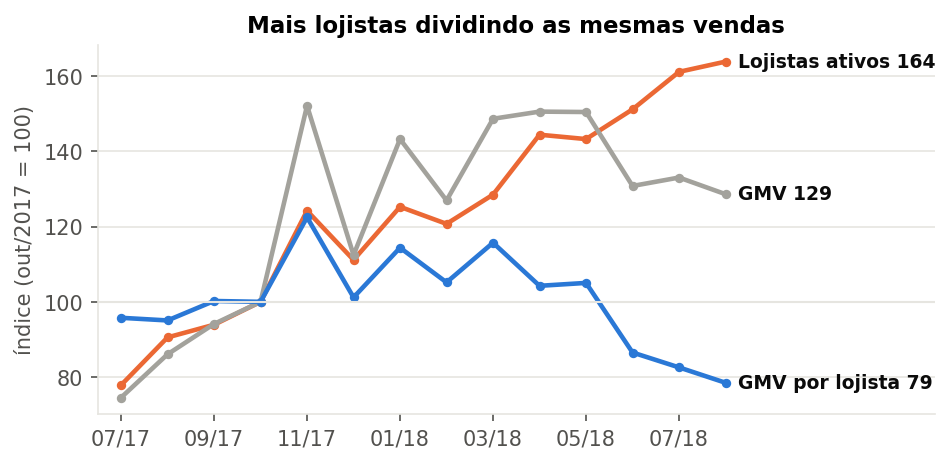

**Metade dos lojistas para de vender, e os primeiros 90 dias são decisivos.** Dos 2.072 lojistas que começaram a vender até fevereiro de 2018, 55% estavam inativos no fim do período. Como a base é uma amostra, parte desse número pode ser apenas acaso: um lojista pequeno pode simplesmente não ter tido pedidos sorteados para a amostra. O cálculo dessa chance indica que o acaso explicaria 22%. A diferença, de cerca de 32 pontos, indica saída real.

O critério de 90 dias foi testado com outros prazos. Com 60 dias sem venda, a saída real fica 29 pontos acima do acaso; com 180 dias, 34 pontos. O padrão por volume inicial se repete nos três casos.

O fator que mais diferencia quem fica de quem sai é o volume de vendas no começo:

| Vendas nos primeiros 90 dias | Lojistas | Ficaram inativos | Esperado apenas pelo acaso |
|---|---|---|---|
| 1 venda | 496 | 80% | 54% |
| 2 vendas | 319 | 72% | 33% |
| 3 a 4 vendas | 361 | 57% | 18% |
| 5 a 9 vendas | 436 | 43% | 5% |
| 10 ou mais | 460 | 24% | 0,3% |

Entre lojistas com volume inicial parecido, atraso e postagem tardia praticamente não alteram a chance de ficar inativo. **O volume de vendas no início é, portanto, o sinal mais forte de saída.** A base não permite dizer qual é a direção: o lojista pode desistir porque vendeu pouco, ou vender pouco porque já estava desistindo.

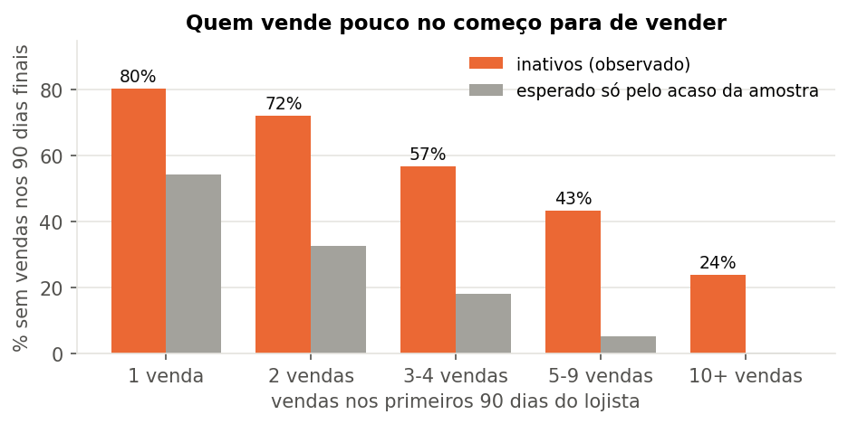

**A saída é gradual e parecida entre as turmas de entrada.** Acompanhando cada lojista desde a primeira venda, 66% ainda vendem após 3 meses, 56% após 6, 47% após 9 e 42% após 12. Agrupando os lojistas pelo trimestre em que começaram (as "safras"), o comportamento é parecido: após 6 meses, entre 55% e 64% continuam ativos, sem melhora ou piora clara ao longo de 2017. A diferença está no começo: entre os lojistas com 5 ou mais vendas nos primeiros 90 dias, 76% continuam após 6 meses e 63% após 12; entre os demais, 38% e 23%.

| Safra (trimestre da primeira venda) | Lojistas | Ativos após 3 meses | Após 6 meses | Após 9 meses | Após 12 meses |
|---|---|---|---|---|---|
| 1º tri/2017 | 551 | 73% | 64% | 57% | 50% |
| 2º tri/2017 | 312 | 69% | 55% | 47% | 34% |
| 3º tri/2017 | 366 | 72% | 62% | 51% | sem tempo de observação |
| 4º tri/2017 | 427 | 68% | 55% | sem tempo de observação | |
| 1º tri/2018 | 368 | 63% | sem tempo de observação | | |

*"Ativo após 6 meses" significa que o lojista teve ao menos uma venda 6 meses ou mais depois da primeira. Cada coluna só inclui as safras que já tinham esse tempo de história na base.*

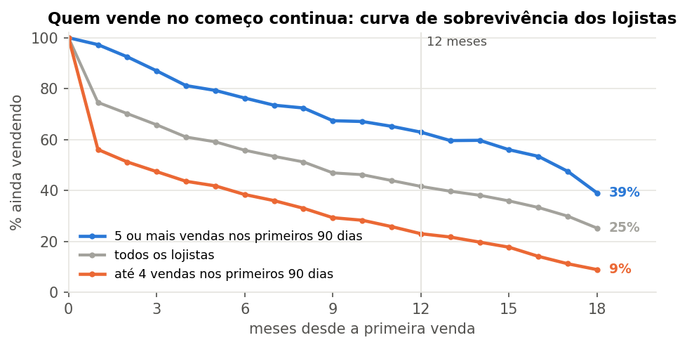

**O lojista novo que deslancha tem frete proporcional e anúncio completo.** Para orientar a ativação, foram comparados os 2.392 lojistas que começaram a vender entre janeiro de 2017 e maio de 2018. Desses, 47% chegaram a 5 ou mais pedidos nos primeiros 90 dias. Um modelo estatístico mediu quanto cada característica muda essa chance, comparando lojistas parecidos em tudo o mais:

| Característica nos primeiros 90 dias | Lojistas | Efeito na chance de chegar a 5 pedidos (pontos) | Margem de erro |
|---|---|---|---|
| Frete acima de 40% do preço do produto | 388 | −13 pontos | −19 a −8 |
| Descrição dos produtos com até 300 caracteres | 293 | −18 pontos | −22 a −13 |
| Primeira venda com nota 1 ou 2 | 372 | −8 pontos | −13 a −3 |
| Primeira venda entregue com atraso | 143 | sem efeito claro | −9 a +6 |
| Lojista em São Paulo | 1.393 | +7 pontos | +3 a +10 |
| Categoria cama, mesa e banho | 103 | +15 pontos | +7 a +23 |
| Categoria móveis e decoração | 156 | −15 pontos | −22 a −9 |

Três cuidados acompanham esse resultado. Primeiro, ele mostra associação, não causa. Segundo, frete, descrição e categorias dão o mesmo resultado quando o critério de sucesso muda (3 ou 10 pedidos, ou valor vendido acima do típico); já o número de fotos e o preço mudam de sinal conforme o critério e ficaram fora das conclusões. Terceiro, a base só registra produtos que venderam, por isso o número de produtos anunciados não pôde ser avaliado.

Na prática, a descrição está nas mãos do lojista. O frete é uma **pergunta aberta**: a base não diz quem define o frete cobrado do comprador. Nos marketplaces, ele costuma ser calculado pelo canal a partir de peso, medidas e distância; o lojista influenciaria pelo peso e pelas medidas que declara, pelo preço e pela localização. Isso precisa ser confirmado com a Olist antes de virar ação (ver `BRIEFING_NEGOCIO.md`, seção 3b). Se os dois fatores puderem ser trabalhados e nenhum lojista novo tivesse frete acima de 40% do preço nem descrição curta, o modelo estima que a parcela dos que deslancham passaria de 47% para 52%; só com a descrição completa, de 47% para 50%.

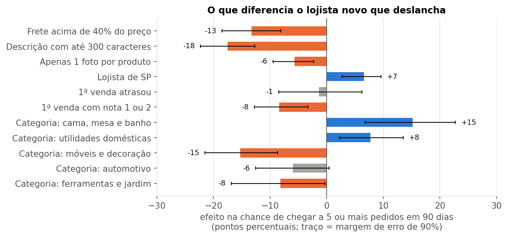

**Poucos lojistas sustentam a maior parte das vendas.** Os lojistas foram agrupados por três critérios: há quanto tempo venderam pela última vez, quantos pedidos fizeram e quanto venderam (técnica conhecida como RFM, de recência, frequência e valor). Os grupos mais relevantes são:

| Grupo | Lojistas | Participação nas vendas dos últimos 90 dias | Leitura |
|---|---|---|---|
| Campeões (vendas recentes e 30 ou mais pedidos) | 451 (15%) | 65% | Sustentam a operação |
| Esfriando ou em risco (já venderam bem, mas pararam ou desaceleraram) | 324 (11%) | 4,6% (17% do histórico) | Alvo de reativação |
| Novos (até 90 dias de casa) | 468 (15%) | 8% | Alvo de ativação; melhor nota de todos os grupos |
| Inativos | 1.129 (37%) | 0% | Metade deles fez no máximo 2 pedidos |

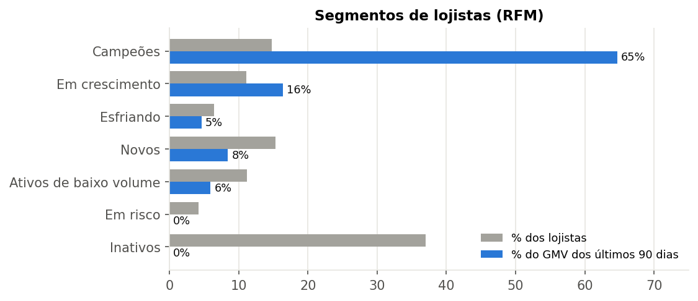

**Um grupo de lojistas concentra as avaliações negativas.** Entre os 628 lojistas com volume suficiente para comparação, 46 recebem nota 1 em 24,5% dos pedidos, contra 10,2% dos demais. Esses 46 respondem por 6% das vendas e 12% das notas 1, e postam os pedidos fora do prazo três vezes mais que os outros. O tamanho do grupo depende da régua usada (testada de 27 formas, o grupo variou entre 17 e 95 lojistas), mas o padrão se repete em todas. Vinte e oito desses lojistas estão entre os Campeões: são lojistas grandes, dos quais a operação depende.

### 2.2 Entrega e reputação

**O atraso é o principal fator de insatisfação.** Pedidos no prazo têm nota média 4,29; atrasados, 2,27. A queda começa no primeiro dia: a nota passa de 4,03, para entregas no dia prometido, para 3,73 com um dia de atraso e 2,68 com três dias.

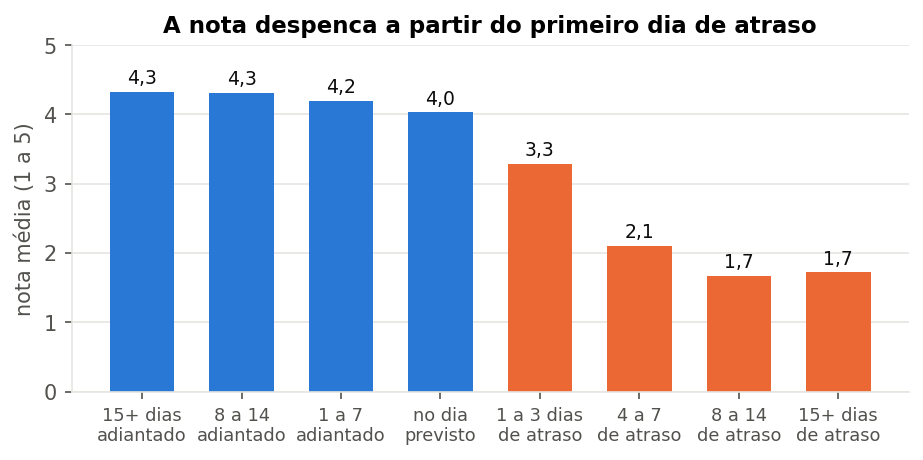

**O atraso nasce no transporte.** Dos dias a mais que um pedido atrasado leva, 87% estão no transporte e 13% na postagem pelo lojista. A postagem leva cerca de 2 dias em todo o país (mediana de 1,8 dia); o transporte vai de 6 dias, no Sudeste, a 16 dias, no Norte. Ainda assim, o lojista tem influência: pedidos postados depois do prazo de envio atrasam em 21% dos casos, contra 5% dos postados em dia.

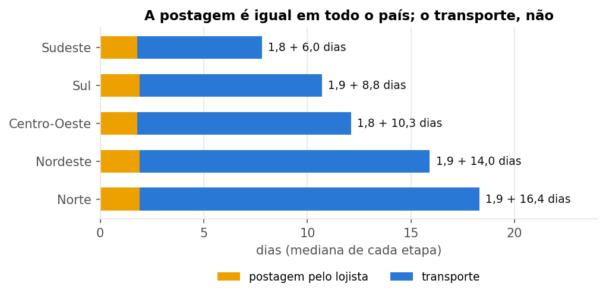

**A nota 1 reflete a operação, não o produto.** Os comentários dos compradores que deram nota 1 foram lidos e classificados com apoio de inteligência artificial. A classificação foi conferida por outras duas leituras independentes de IA e por uma amostra classificada por uma pessoa (ver "Método"). Nos 8.613 comentários do período:

- 42,5% tratam de **entrega** (pedido não recebido, atrasado ou extraviado);
- 31,8% tratam de **erro de envio ou de estoque** (pedido incompleto, produto errado, produto indisponível);
- 18,4% tratam do **produto** (defeito ou qualidade abaixo do anunciado);
- 1,9% tratam apenas do atendimento.

Na amostra conferida por uma pessoa, entrega e erro de envio somaram 75% dos casos, contra 79% na classificação da IA. A divisão entre "não recebido" e "atraso" depende da definição adotada e não deve ser lida isoladamente.

Dois detalhes chamam atenção. Em 83% das reclamações de "não recebido", o comprador avaliou antes de o pedido chegar, porque a pesquisa de satisfação é enviada logo após a data prometida. E 82% das reclamações de "pedido incompleto" vêm de compras com vários itens, entregues em pacotes separados sem que o comprador fosse avisado.

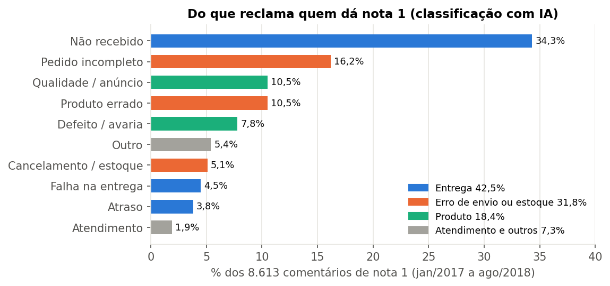

**A promessa de prazo não está ajustada à realidade de cada rota.** Em média, o pedido chega 12 dias antes do prometido, e chegar muito antes quase não melhora a nota. Reduzir todas as promessas por igual, porém, aumentaria o atraso nas rotas lentas: dois dias a menos elevariam o atraso de 6,7% para 9,6%.

A alternativa testada foi definir a promessa de cada rota (do estado do lojista ao estado do comprador) como o prazo em que 93% das entregas daquela rota chegaram em 2017, e aplicá-la aos pedidos de 2018, que não participaram da definição. Nos pedidos de 2018, o prazo exibido cairia de 23 para 21 dias, com o mesmo nível de atraso (7,8% hoje, 7,5% com a promessa ajustada) e de nota. Por região:

| Região do comprador | Promessa atual | Promessa ajustada | Atraso atual | Atraso com a promessa ajustada |
|---|---|---|---|---|
| Sudeste | 21 dias | 17 dias | 7,0% | 7,3% |
| Sul | 26 dias | 24 dias | 6,9% | 7,9% |
| Centro-Oeste | 26 dias | 24 dias | 8,0% | 7,6% |
| Nordeste | 29 dias | 34 dias | 14,4% | 7,3% |
| Norte | 37 dias | 38 dias | 12,0% | 14,4% |

*Pedidos de 2018; promessa típica (mediana) de cada região.*

A simulação supõe que o comprador reagiria a um atraso como os compradores atrasados reagem hoje. Ela não mede o efeito sobre as vendas, porque a base não tem dados de visitas.

**No Nordeste, há um custo a considerar.** A seção 2.3 mostra que prazos maiores andam junto com menos compradores. Uma promessa 5 dias mais longa pode, portanto, reduzir as vendas no Nordeste, em troca de menos atraso e melhor reputação. No Sudeste, o ajuste é favorável nos dois sentidos: promessa mais curta e mesma nota. Por isso, a mudança deve começar como piloto em algumas rotas, medindo vendas, atraso e nota antes de ser ampliada.

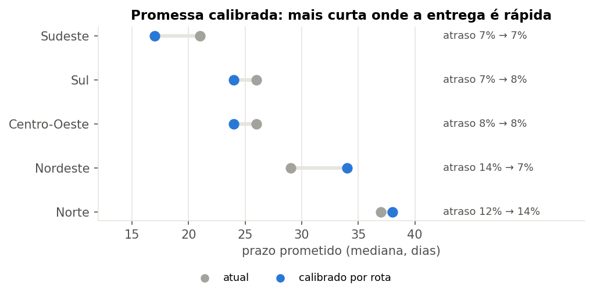

**Os picos de demanda concentram o desgaste.** Na Black Friday de 2017, foram 1.166 pedidos em um único dia, sete vezes o normal. Com a mesma promessa de 23 dias, o atraso subiu de 4,9% para 17,3% e a nota caiu de 4,19 para 3,85. A base tem apenas uma Black Friday, por isso o resultado não pôde ser comparado com outros anos.

### 2.3 Demanda e geografia

**Quanto maior o prazo, menor a parcela da população que compra.** São Paulo, com entrega típica em 7 dias, tem 88 compradores a cada 100 mil habitantes; o Amazonas, com 26 dias, tem 3,5.

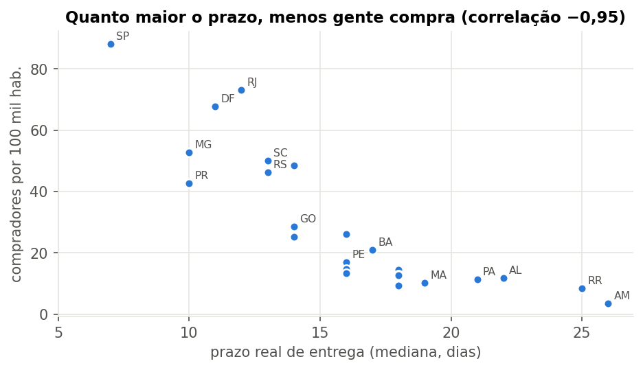

**O prazo pesa mais que a renda.** Um modelo estatístico com os 27 estados mostra que renda e prazo, juntos, explicam 90% da diferença entre eles, e que o prazo pesa mais. Entre estados de renda parecida, cada dia a menos de prazo acompanha cerca de 12% mais compradores por habitante, com margem de erro entre 8% e 16%. Mantida a renda de cada estado, os cenários são:

| Cenário | Compradores a mais | Margem de erro | Aumento sobre os 95 mil atuais |
|---|---|---|---|
| 2 dias a menos em cada estado | 14 mil | de 10 mil a 19 mil | +15% |
| 4 dias a menos em cada estado | 29 mil | de 19 mil a 41 mil | +31% |
| Prazo de São Paulo em todo o país | 61 mil | de 37 mil a 93 mil | +64% |

Esses números projetam, para o país, uma comparação entre 27 estados; não são um efeito comprovado. O tempo necessário para alcançar cada cenário depende de investimentos que a base não permite estimar.

**O frete quase dobra longe do Sudeste.** Para produtos de R$ 50 a R$ 100, o frete equivale a 21% do preço no Sudeste, 37% no Nordeste e 41% no Norte. Em produtos de até R$ 50, chega a 84% do preço no Norte. Nos estados mais distantes, os compradores levam proporcionalmente menos itens baratos. Nos pedidos entregues no prazo, porém, o valor do frete quase não altera a nota: o comprador aceita o frete que vê antes de pagar, mas não aceita o atraso.

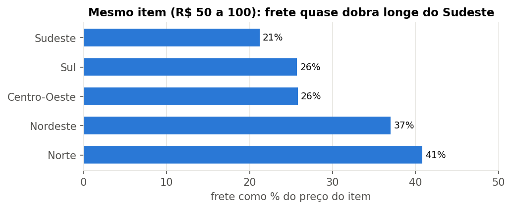

**Lojistas próximos do comprador entregam mais rápido e mais barato:**

| | Lojista no mesmo estado do comprador | Lojista em outro estado |
|---|---|---|
| Tempo de transporte (típico) | 3,7 dias | 9,2 dias |
| Pedidos atrasados | 4,6% | 8,1% |
| Frete médio por item | R$ 13,45 | R$ 23,69 |

### 2.4 Vendas, categorias e comprador

**As vendas pararam de crescer em 2018 por falta de pedidos, não por queda do valor de cada compra.** De janeiro a agosto, as vendas de 2018 foram 138% maiores que as do mesmo período de 2017, mas ficaram estáveis ao longo de 2018, entre R$ 840 mil e R$ 990 mil por mês. O valor médio por pedido (ticket) oscilou entre R$ 125 e R$ 153, com cerca de 1,1 item por pedido, sem tendência de queda. A estabilidade vem, portanto, do número de pedidos, enquanto o número de lojistas continuou crescendo. Por se tratar de amostra, essa tendência deve ser lida com cautela.

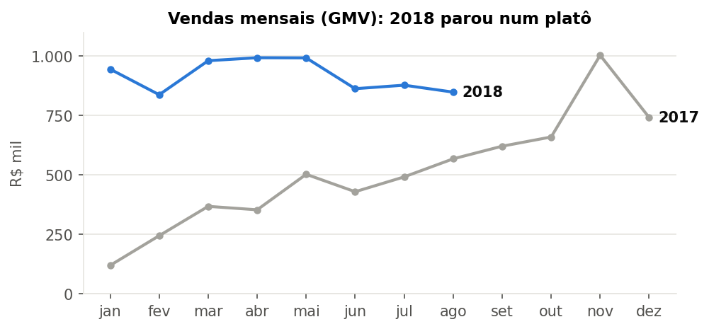

**Em algumas categorias, entraram muito mais lojistas do que compradores.** Comparando janeiro a agosto de 2018 com o mesmo período de 2017, a venda por lojista ativo subiu 23% no total, mas caiu em quatro das 15 maiores categorias:

| Categoria | Lojistas ativos | Vendas | Venda por lojista |
|---|---|---|---|
| Perfumaria | +152% | +43% | −43% |
| Brinquedos | +135% | +42% | −40% |
| Cool stuff | +32% | +9% | −18% |
| Cama, mesa e banho | +129% | +107% | −9% |
| Total das categorias | +94% | +138% | +23% |

Lojistas que estrearam em 2018 fizeram 30% das vendas de janeiro a agosto daquele ano. As categorias com excesso de lojistas merecem atenção na captação e na ativação: um lojista novo nelas disputa uma demanda que cresce menos que a concorrência.

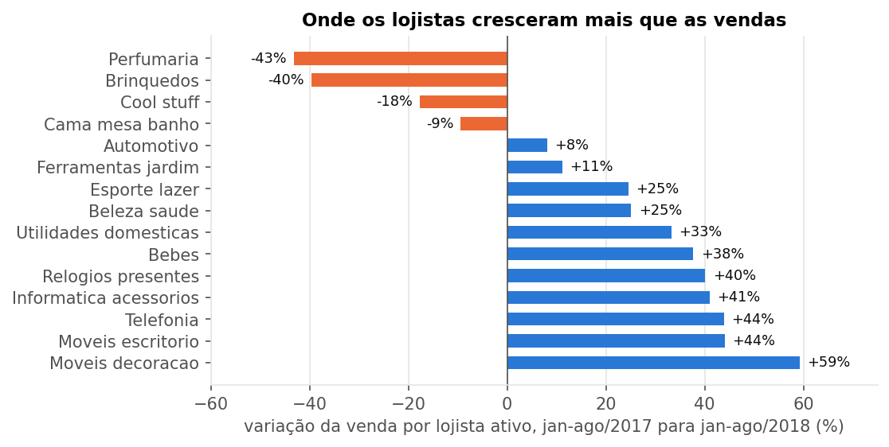

- **Vendas distribuídas entre muitos produtos.** 18 de 74 categorias somam 80% das vendas, lideradas por beleza e saúde (9,3%). O produto mais vendido representa só 0,47% do total.
- **Perdas pequenas e concentradas antes do envio.** Cancelamentos e indisponibilidades representam 1,2% dos pedidos e 1,7% do valor, quase sempre entre a aprovação do pagamento e o envio. Em pedidos acima de R$ 1.000, a perda chega a 3,75%.
- **O comprador raramente volta pela mesma via.** Só 1,31% dos compradores fazem nova compra em até 90 dias (1,99% em até 180 dias). Esse número interessa à Olist como sinal de saúde do canal, porque o relacionamento com o comprador pertence ao marketplace.

---

## 3. Interpretação

1. **O principal desafio é ajudar o lojista a vender no começo.** O volume inicial é o sinal mais forte de saída, e a qualidade da operação pouco o explica. Anúncio incompleto é o ponto de partida concreto para a ativação; o frete desproporcional também pesa, mas quem o controla ainda precisa ser confirmado.
2. **Trazer lojistas sem trazer compradores dilui o resultado de todos.** Isso já ocorre em categorias como perfumaria e brinquedos. Ações que aumentam as vendas, como reduzir prazo e frete, também ajudam a manter os lojistas.
3. **A reputação coletiva é o ativo que dá visibilidade a todos os lojistas.** Ela é desgastada principalmente pelo transporte e pelos erros de envio, muitas vezes de lojistas grandes. Apoiar esses lojistas a melhorar protege toda a base.
4. **Parte das notas negativas pode ser evitada com ajustes de processo.** A avaliação pedida antes da entrega, a entrega em partes sem aviso e a promessa de prazo uniforme geram insatisfação que não depende do lojista.
5. **A distância limita mais as vendas do que a renda.** Lojistas próximos dos compradores reduzem prazo, atraso e frete ao mesmo tempo.

---

## 4. Soluções propostas, ordenadas por custo

As soluções estão em ordem crescente de custo estimado, separando o **custo financeiro** (investimento, sistemas, receita que deixa de entrar) do **custo humano** (pessoas e tempo de equipe). Como a base não tem dados de custo, a classificação é qualitativa e serve para decidir **o que estudar primeiro**.

| # | Solução | Custo financeiro | Custo humano | Potencial |
|---|---|---|---|---|
| 1 | Ajustar a promessa de prazo a cada rota, começando por um piloto | Baixo | Baixo | Alto: prazo exibido menor onde a entrega é rápida e menos atraso onde é lenta |
| 2 | Pedir a avaliação só depois da entrega e separar a avaliação por lojista | Baixo | Baixo | Médio: elimina notas dadas a pedidos ainda em trânsito ou a outro lojista |
| 3 | Avisar o comprador quando o pedido vier em vários pacotes | Baixo | Baixo | Médio: reduz as queixas de "pedido incompleto" |
| 4 | Alertar o lojista antes do fim do prazo de postagem | Baixo | Baixo | Médio: a postagem tardia multiplica o atraso por quatro |
| 5 | Oferecer ao lojista um painel com seus indicadores e as reclamações recebidas | Baixo a médio | Baixo | Médio: o lojista passa a ver e corrigir o que afeta a reputação |
| 6 | Ampliar a promessa de prazo na semana da Black Friday | Baixo | Baixo | Médio: evita o salto de atraso do pico |
| 7 | Programa de ativação do lojista novo: descrição completa dos anúncios, acompanhamento da primeira venda, orientação sobre categorias com excesso de oferta e, **se o lojista controlar o frete**, revisão dos produtos com frete acima de 40% do preço | Baixo a médio | Médio | Alto: os primeiros 90 dias são o melhor sinal de quem fica |
| 8 | Reativação dos lojistas que esfriaram: contato, diagnóstico e campanhas | Baixo | Médio | Alto: 324 lojistas que já venderam bem |
| 9 | Programa de reconhecimento: menor comissão e mais exposição para lojistas bem avaliados, com o lojista corresponsável pela transportadora que escolhe | Médio | Baixo | Médio a alto: incentiva a nota, que o lojista controla |
| 10 | Campanhas de segunda compra em parceria com os marketplaces, em datas como a Black Friday | Médio | Médio | Médio: a recompra é baixa, mas o comprador pertence ao marketplace |
| 11 | Atrair lojistas no Norte e no Nordeste | Médio | Alto | Alto: lojista próximo reduz prazo e frete |
| 12 | Frete subsidiado ou consolidado para produtos baratos vendidos a regiões distantes | Alto | Médio | Médio: o frete chega a 84% do preço nesses casos |
| 13 | Centros logísticos próximos do comprador (entrega final, ou "última milha") no Sul, Sudeste e Centro-Oeste | Alto | Alto | Alto: 87% do atraso está no transporte |
| 14 | Transportadora própria do marketplace, voltada à eficiência das entregas (horizonte de longo prazo) | Muito alto | Alto | Alto, a validar |

**Sequência sugerida:** nos primeiros 90 dias, pilotos das soluções 1, 2 e 7 (ver o sumário executivo), com as soluções 3 e 4 implantadas em paralelo, por terem custo baixo e pouco risco. Em seguida, as soluções 5, 6 e 8; depois, 9 e 10; por último, os investimentos estruturais (11 a 14).

---

## 5. Acompanhamento

### Indicadores e metas

Os valores atuais referem-se à amostra e ao período padrão, salvo indicação. A coluna "Apoio nos dados" diz de onde vem cada meta. Só quatro metas têm apoio direto na base; as demais ficam **em aberto**, para serem definidas pela Olist com dados que este estudo não tem (custos, histórico de ações e conversão). Nenhuma meta foi inventada para preencher a tabela.

| Indicador | Valor atual | Meta inicial | Apoio nos dados | Frequência | Área responsável |
|---|---|---|---|---|---|
| Lojistas novos com 5 ou mais pedidos nos primeiros 90 dias | 47% | 50% (52% se o lojista controlar o frete) | **Modelo de ativação**: cenário sem descrição curta; com frete também, 52%. Supõe que mudar esses fatores muda o resultado, o que só o piloto confirma | Mensal, por safra de entrada | Sucesso do lojista |
| Pedidos atrasados no Nordeste | 12,8% | Até 8% | **Simulação da promessa por rota** (7,3% nos pedidos de 2018). Supõe que os compradores reagiriam ao atraso como hoje | Mensal, por região | Logística |
| Promessa de prazo exibida no Sudeste | 21 dias | 17 dias, sem aumento de atraso | **Simulação da promessa por rota** | Mensal, por rota | Logística e produto |
| Pedidos postados fora do prazo | 9,0% | 7,7% | **Referência observada**: nível dos lojistas fora do grupo de 46 | Semanal | Sucesso do lojista |
| Participação das notas 1 | 10,7% | Em aberto | As notas 1 de "não recebido" dadas antes da entrega somam 2,3% dos pedidos avaliados; quanto disso a avaliação após a entrega evita, só o piloto dirá | Mensal | Produto e experiência |
| Lojistas inativos acima do esperado pelo acaso | 32 pontos (55% contra 22%) | Em aberto | O efeito da ativação sobre a saída não pode ser estimado com a base | Trimestral | Sucesso do lojista |
| Vendas por lojista ativo | R$ 671 por mês (agosto de 2018) | Em aberto; a direção é interromper a queda | Não há referência de patamar sustentável na base | Mensal | Comercial |
| Lojistas esfriando ou em risco reativados | 324 no grupo | Em aberto | Não há histórico de ações de reativação na base | Mensal | Sucesso do lojista |
| Nota média | 4,12 | Acompanhar | Consequência das metas acima; sem meta própria | Mensal | Produto e experiência |
| Motivos das notas 1 | entrega 42,5%; envio 31,8%; produto 18,4% | Acompanhar | A direção esperada é a queda da participação de entrega, sem número | Trimestral | Dados |
| Compradores por 100 mil habitantes, por estado | de 3,5 (AM) a 88 (SP) | Acompanhar | Depende dos investimentos 11 a 13, que a base não permite dimensionar | Semestral | Comercial e logística |
| Recompra do comprador em 90 dias | 1,31% | Em aberto | O comprador pertence ao marketplace; meta a combinar com ele | Trimestral | Parcerias |

### Como ajustar

- Testar cada solução em pequena escala antes de ampliá-la, comparando o resultado com um grupo que não recebeu a ação.
- Revisar os indicadores na frequência indicada. O que funcionar torna-se padrão; o que não funcionar é ajustado ou abandonado.
- Repetir a classificação dos comentários negativos a cada trimestre, para acompanhar a mudança dos motivos.

---

## Método

**Divisão do trabalho.** Fabian Aliatti Mayer definiu as perguntas, escolheu os critérios de análise, revisou e aprovou cada resultado e formulou as soluções de negócio. A inteligência artificial (Claude) escreveu as consultas e os programas, executou as análises, classificou os comentários e redigiu os textos para revisão. Todas as decisões estão registradas, pergunta a pergunta, em `DIARIO_DECISOES.md`. A correspondência entre os temas do relatório e as análises está no Anexo B.

**Execução.** As consultas da pasta `sql/` (perguntas Q1 a Q10) foram escritas no dialeto do DuckDB; `scripts/rodar_sql.py` as executa no DuckDB ou, traduzindo as poucas funções que mudam, em uma cópia SQLite da base, que foi o caminho usado nos resultados publicados. As demais análises são programas em Python (pasta `scripts/`), que também produzem os modelos, as simulações e os gráficos. As tabelas de geolocalização e de pagamentos não foram usadas: a distância entre lojista e comprador foi aproximada pelo estado, e a forma de pagamento não entrou nas perguntas; ficam como extensões possíveis.

**Classificação dos comentários.** Os 8.706 comentários de nota 1 da base foram classificados em 10 temas por agentes de inteligência artificial, seguindo regras fixas (`metodo/qC_instrucoes_classificacao_ia.md`). A classificação foi validada de duas formas, usando o índice kappa, que mede a concordância descontando o acaso (de 0 a 1; acima de 0,6 é boa e acima de 0,8, excelente):

- **Consistência entre IAs:** duas novas classificações independentes de 1.000 comentários, uma com outro modelo de IA e outra com instruções redigidas de outra forma, concordaram com a original em 95% dos casos (kappa de 0,93 a 0,95). Isso mostra que o resultado não depende de uma leitura isolada, mas não prova que está certo, porque IAs semelhantes tendem a errar nos mesmos casos.
- **Comparação com uma pessoa:** Fabian classificou 149 comentários sorteados sem ver os rótulos da IA. A concordância foi de 84% nos grandes grupos (entrega, envio e estoque, produto, outros; kappa de 0,76, boa) e de 63% nos 10 temas detalhados (kappa de 0,57, moderada). A principal diferença foi de definição: comentários de pedidos ainda não recebidos com prazo vencido foram classificados como "atraso" pela pessoa e como "não recebido" pela IA, como mandava a regra. Unindo esses dois temas, a concordância sobe para 79% (kappa de 0,73). Por isso, o relatório usa os resultados por grupo e trata a divisão fina dentro da entrega com cautela.

**Modelo de ativação.** Regressão logística com 2.327 lojistas que tinham todas as informações. Os efeitos são apresentados em pontos percentuais da chance de chegar a 5 pedidos, com as demais características fixas. O modelo foi refeito com três outros critérios de sucesso para verificar quais resultados se mantêm.

**Margens de erro.** Foram calculadas por reamostragem dos dados (bootstrap). Elas indicam a variação esperada nos resultados, mas não garantem que as hipóteses dos modelos estejam corretas.

**Validação e conferência.** Antes das análises, `scripts/validar_dados.py` confere a base bruta (contagens, chaves, datas, nulos e valores) e grava o resultado em `resultados/validacao_dados.csv`. Ao final, `scripts/conferir_relatorio.py` lê os CSVs de resultados e verifica se os números-chave deste relatório aparecem no texto (`resultados/conferencia_relatorio.csv`).

**Reprodução.** Baixar a base no Kaggle (*Brazilian E-Commerce Public Dataset by Olist*), salvar os arquivos em `dados/brutos/`, instalar os pacotes de `requirements.txt` e executar `scripts/rodar_tudo.py`, que roda a validação, as consultas SQL, as análises, os indicadores, os gráficos, o painel e a conferência, nessa ordem. O `README.md` traz os detalhes.

**Fontes:** *Brazilian E-Commerce Public Dataset by Olist* (Kaggle, licença CC BY-NC-SA 4.0); IBGE, SIDRA tabelas 6579 e 7531. Os textos dos comentários não são publicados, apenas a classificação de cada pedido.

---

## Anexo A. Dicionário de indicadores

**Regras gerais**, usadas no relatório e no painel (`index.html`):

| Item | Definição |
|---|---|
| Período padrão | Pedidos feitos de janeiro de 2017 a agosto de 2018 |
| Pedidos efetivos | Todos os pedidos, exceto cancelados e indisponíveis |
| Vendas ou GMV | Soma do preço dos itens, sem frete |
| Prazo de entrega | Dias da compra à entrega, só pedidos entregues, em mediana |
| Prazo prometido | Dias da compra à data prometida ao comprador, em mediana |
| Pedido atrasado | Entregue depois da data prometida; percentual sobre os entregues |
| Postagem e transporte | Postagem: da aprovação do pagamento à entrega à transportadora. Transporte: da transportadora ao comprador. Ambos em mediana |
| Postagem fora do prazo | Pedido entregue à transportadora depois do prazo de envio do lojista |
| Nota | Avaliação mais recente de cada pedido, em média |
| Lojista ativo no mês | Lojista com ao menos um pedido efetivo no mês |
| Lojista inativo | Sem venda nos 90 dias anteriores a 1º de setembro de 2018 |

**Análises com base própria:**

| Análise | Base | Motivo |
|---|---|---|
| Retenção (seção 2.1) | Lojistas com primeira venda até fevereiro de 2018 | Ter ao menos seis meses para mostrar atividade |
| Ativação (seção 2.1) | Lojistas com primeira venda de janeiro de 2017 a maio de 2018 | Ter 90 dias completos antes do fim da base |
| Safras e sobrevivência (seção 2.1) | Lojistas com primeira venda a partir de janeiro de 2017; cada ponto da curva usa só os lojistas com aquele tempo de observação | Não penalizar as safras recentes pela falta de tempo |
| Grupos RFM | Toda a base até agosto de 2018 | Histórico completo de cada lojista |
| 46 lojistas com excesso de notas 1 | Toda a base; lojistas com volume suficiente para comparação | Histórico completo de cada lojista |
| Temas das notas 1 | Notas 1 com comentário no período padrão, **inclusive pedidos cancelados** | As queixas de estoque vêm dos pedidos cancelados |
| Promessa por rota | Regra aprendida nos pedidos entregues de 2017 e testada nos de 2018 | Testar a regra em dados que não a criaram |
| Nota conforme o atraso e corte uniforme da promessa | Pedidos entregues e avaliados de toda a base | Maior número de casos por dia de atraso |
| Black Friday | Outubro a dezembro de 2017 | Única Black Friday da base |
| Estados, renda e prazo | Compradores por estado, população e renda de 2017 | Comparação entre os 27 estados |
| Categorias | Janeiro a agosto de 2017 e de 2018 | Mesmos meses, sem efeito de sazonalidade |
| Recompra | Compradores com ao menos 90 dias de observação | Janela de 90 dias |

Os valores gerais do período padrão estão em `resultados/indicadores_padrao.csv`, gerado por `scripts/indicadores_padrao.py`. São os mesmos que o painel mostra sem filtros.

---

---

## Anexo B. Referência das análises e arquivos do projeto

| Tema | Análise no diário e nos arquivos |
|---|---|
| Vendas por categoria e produtos | Q1, Q3 |
| Atraso e avaliação | Q2 |
| Peso do frete | Q3b, B |
| Maiores lojistas | Q4 |
| Cancelamentos | Q5, Q5b, Q6 |
| Recompra do comprador | Q7 e revisão em 90 dias |
| Estados, população, renda e prazo | Q8, Q8b |
| Vendas mensais | Q9 |
| Black Friday | Q10 |
| Etapas da entrega | A |
| Comentários de nota 1 | C |
| Lojistas com excesso de notas negativas | D |
| Retenção dos lojistas e sensibilidade da inatividade | E |
| Safras e curva de sobrevivência dos lojistas | J |
| Estabilidade da amostra no tempo | K |
| Grupos de lojistas (RFM) | F |
| Promessa de prazo | G |
| Ativação do lojista novo | H |
| Ticket e categorias ligadas aos lojistas | I |
| Indicadores no período padrão | indicadores_padrao |

**Arquivos do projeto:** `README.md` (como reproduzir), `RELATORIO.md` e `RELATORIO.pdf` (este relatório), `index.html` (painel interativo), `BRIEFING_NEGOCIO.md`, `DIARIO_DECISOES.md`, `RESUMO_DADOS.md`, `requirements.txt`, pastas `sql/`, `scripts/`, `metodo/`, `dados/externos/` e `resultados/`.
